# CardioSense: An Explainable Machine Learning System for Early Coronary Heart Disease Risk Prediction and Personalized Prevention

**Project Type:** College Mini Project  
**Dataset:** Framingham Heart Study (`data/framingham.csv`)  
**Repository Artifacts:** `src/`, `notebooks/`, `models/`, `app/`, `tests/`, `reports/`

---

## Abstract

Coronary heart disease (CHD) remains a leading cause of global morbidity and mortality, making early, interpretable risk stratification essential for preventive care. This report presents **CardioSense**, an end-to-end explainable machine learning system for predicting 10-year CHD risk using the Framingham Heart Study dataset (4,238 patients, 15 clinical features, 15.2% positive class). To prevent data leakage, a stratified 80/20 train–test split (3,390 training / 848 test rows) is performed prior to all preprocessing. Median/mode imputation, feature scaling, and Synthetic Minority Over-sampling Technique (SMOTE) resampling are encapsulated within an `imblearn` pipeline fitted strictly on training folds. Three classifiers—Logistic Regression, Random Forest, and XGBoost—are tuned via 5-fold stratified cross-validation. Logistic Regression achieves the highest held-out test ROC-AUC (0.6985) and is selected as the final model. Lowering the decision threshold from 0.50 to 0.41 increases CHD recall from 60.47% to 74.42% (precision 21.52%), prioritizing screening sensitivity. Model transparency is provided through global and local SHAP (`LinearExplainer`) and LIME explanations, paired with a guideline-based preventive recommendation engine and an interactive Streamlit dashboard. CardioSense is an academic decision-support prototype and not a clinical diagnostic tool.

---

## 1. Introduction and Problem Statement

Cardiovascular diseases, particularly coronary heart disease (CHD), represent the foremost cause of premature mortality worldwide. Early identification of asymptomatic individuals at elevated 10-year CHD risk enables timely lifestyle modification and targeted pharmacological intervention before acute myocardial infarction or sudden cardiac death occurs. Traditional clinical risk calculators, most notably the Framingham Risk Score introduced by Wilson et al. (1998), rely on fixed point-scoring tables derived from Cox proportional hazards models. While interpretable, static scoring sheets cannot easily incorporate automated missing-data handling, class-imbalance-aware probability calibration, or modern instance-level explainability.

Conversely, modern machine learning (ML) classifiers often suffer from three recurring pitfalls when applied to clinical tabular datasets:

1. **Data and Label Leakage:** Applying imputation, standardization, or oversampling (such as SMOTE) to the entire dataset before splitting leaks test-set statistics into training, producing overly optimistic cross-validation and test metrics.
2. **Class Imbalance Neglect:** Because 10-year CHD incidence in longitudinal cohorts is typically around 15%, standard classifiers optimized for accuracy default to predicting the majority "No CHD" class, yielding unacceptably low sensitivity (recall) for high-risk patients.
3. **Lack of Clinical Transparency ("Black-Box" Predictions):** Delivering a raw probability score without explaining *which* patient measurements drove the prediction undermines clinician and patient trust, and offers no actionable pathway toward risk reduction.

**CardioSense** addresses these three challenges by combining a strictly leakage-free `imblearn` preprocessing and resampling pipeline, recall-oriented decision threshold tuning, exact game-theoretic local and global explanations (SHAP and LIME), and a clinical-guideline-grounded preventive recommendation engine inside an interactive web dashboard.

---

## 2. Objectives

The primary objectives of the CardioSense project are:

1. **Exploratory Data Analysis (EDA):** Systematically inspect the Framingham dataset (`data/framingham.csv`) for feature distributions, missingness patterns, duplicate records, class imbalance, correlations, and outliers (`notebooks/01_eda.ipynb`).
2. **Leakage-Free Modeling Pipeline:** Construct an end-to-end `imblearn.pipeline.Pipeline` that isolates a stratified 80/20 train–test split upfront and confines imputation, `StandardScaler`, and SMOTE strictly to training folds (`src/train.py`, `notebooks/02_modeling.ipynb`).
3. **Model Benchmarking and Threshold Optimization:** Tune and compare Logistic Regression, Random Forest, and XGBoost using 5-fold stratified cross-validation, evaluate on the held-out test set using ROC-AUC, PR-AUC, recall, precision, F1-score, and confusion matrices, and optimize the decision threshold for CHD screening recall.
4. **Explainable AI (XAI) Integration:** Implement global and local SHAP explanations alongside LIME tabular explanations (`src/explain.py`, `notebooks/03_explainability.ipynb`), and expose a reusable `explain_patient()` API.
5. **Personalized Preventive Guidance:** Build a rule-based recommendation module (`src/recommend.py`) that stratifies predicted probabilities into Low, Moderate, and High risk tiers and generates targeted lifestyle/clinical advice strictly for elevated modifiable risk factors.
6. **Interactive Dashboard and Verification:** Deploy a user-friendly Streamlit application (`app/app.py`) with input validation, tooltips, visual risk gauges, SHAP waterfalls, and model performance diagnostics, verified end-to-end against representative patient profiles (`tests/test_samples.py`).

---

## 3. Literature Review

Research in cardiovascular risk prediction and explainable clinical AI spans epidemiological scoring models, imbalanced learning techniques, and post-hoc attribution frameworks:

1. **Framingham Risk Score (Wilson et al., 1998):** Wilson et al. published the landmark categorical 10-year CHD risk prediction algorithm in *Circulation* using data from the Framingham Heart Study. By organizing blood pressure, total cholesterol, smoking status, diabetes, and age into clinically meaningful risk categories, the study established the foundation for modern primary-care cardiovascular screening. CardioSense builds on the same core Framingham predictor set while automating preprocessing and adding instance-level feature attributions.
2. **Synthetic Minority Over-sampling Technique — SMOTE (Chawla et al., 2002):** Medical screening datasets are characteristically imbalanced. Chawla et al. introduced SMOTE in the *Journal of Artificial Intelligence Research*, demonstrating that interpolating synthetic minority-class instances in feature space along $k$-nearest neighbor line segments mitigates majority-class bias more effectively than naive random oversampling with replacement. In CardioSense, SMOTE is embedded inside `imblearn.pipeline.Pipeline` so synthetic samples are generated exclusively within training folds.
3. **LIME — Local Interpretable Model-Agnostic Explanations (Ribeiro et al., 2016):** Presented at ACM SIGKDD, Ribeiro et al. proposed LIME to explain individual predictions of any black-box classifier by fitting a sparse, interpretable linear surrogate locally on perturbed samples around the query instance. LIME provides intuitive threshold-based rules (e.g., `Age > ...`), which CardioSense uses as a complementary sanity check alongside SHAP.
4. **SHAP — SHapley Additive exPlanations (Lundberg & Lee, 2017):** Introduced at NeurIPS, Lundberg and Lee unified additive feature attribution methods under cooperative game theory's Shapley values, proving a unique solution satisfying *local accuracy*, *missingness*, and *consistency*. For linear models such as Logistic Regression, `shap.LinearExplainer` computes exact, deterministic feature attributions in log-odds space without sampling variance.
5. **ACC/AHA Primary Prevention Guidelines (Arnett et al., 2019):** The 2019 American College of Cardiology / American Heart Association Guideline on the Primary Prevention of Cardiovascular Disease emphasizes quantitative 10-year risk estimation paired with clinician–patient risk discussions targeting modifiable behaviors—smoking cessation, blood pressure control (< 130/80 mmHg), lipid management, healthy weight (BMI 18.5–24.9 kg/m²), and glycemic control. These clinical thresholds directly inform CardioSense's recommendation engine (`src/recommend.py`).

---

## 4. Dataset Description

### 4.1 Source and Overview

CardioSense uses the Framingham Heart Study dataset (`data/framingham.csv`), originally collected from an ongoing prospective cardiovascular cohort study in Framingham, Massachusetts. The dataset contains **4,238 patient records** and **16 columns**: **15 predictor features** spanning demographics, lifestyle, clinical measurements, and medical history, plus **1 binary target** (`TenYearCHD`, indicating whether the patient developed coronary heart disease within a 10-year follow-up window). Exploratory checks (`notebooks/01_eda.ipynb`) confirmed **0 exact duplicate rows** and **0 duplicate feature vectors**.

### 4.2 Feature Inventory and Missing Values

Across all 4,238 rows, there are **645 missing cells** affecting **582 rows (13.73%)** across 7 columns, while the remaining 9 columns are 100% complete. Table 1 summarizes all 15 predictor features, their data types, preprocessing roles, and missing-value counts.

**Table 1.** Framingham dataset feature descriptions, types, and missingness (`N = 4,238`).

| # | Feature | Description | Type / Role | Missing Count (%) |
|---|---------|-------------|-------------|-------------------|
| 1 | `age` | Patient age in years (range: 32–70) | Numeric | 0 (0.00%) |
| 2 | `cigsPerDay` | Average cigarettes smoked per day (0–70) | Numeric | 29 (0.68%) |
| 3 | `totChol` | Total serum cholesterol in mg/dL (107–696) | Numeric | 50 (1.18%) |
| 4 | `sysBP` | Systolic blood pressure in mmHg (83.5–295.0) | Numeric | 0 (0.00%) |
| 5 | `diaBP` | Diastolic blood pressure in mmHg (48.0–142.5) | Numeric | 0 (0.00%) |
| 6 | `BMI` | Body Mass Index in kg/m² (15.54–56.80) | Numeric | 19 (0.45%) |
| 7 | `heartRate` | Resting heart rate in bpm (44–143) | Numeric | 1 (0.02%) |
| 8 | `glucose` | Fasting blood glucose in mg/dL (40–394) | Numeric | 388 (9.16%) |
| 9 | `male` | Biological sex (1 = Male, 0 = Female) | Binary / Categorical | 0 (0.00%) |
| 10 | `education` | Education level (1 = Some HS to 4 = College+) | Ordinal / Categorical | 105 (2.48%) |
| 11 | `currentSmoker` | Current smoking status (1 = Yes, 0 = No) | Binary / Categorical | 0 (0.00%) |
| 12 | `BPMeds` | On antihypertensive medication (1 = Yes, 0 = No) | Binary / Categorical | 53 (1.25%) |
| 13 | `prevalentStroke` | History of prior stroke (1 = Yes, 0 = No) | Binary / Categorical | 0 (0.00%) |
| 14 | `prevalentHyp` | History of hypertension (1 = Yes, 0 = No) | Binary / Categorical | 0 (0.00%) |
| 15 | `diabetes` | History of diabetes mellitus (1 = Yes, 0 = No) | Binary / Categorical | 0 (0.00%) |

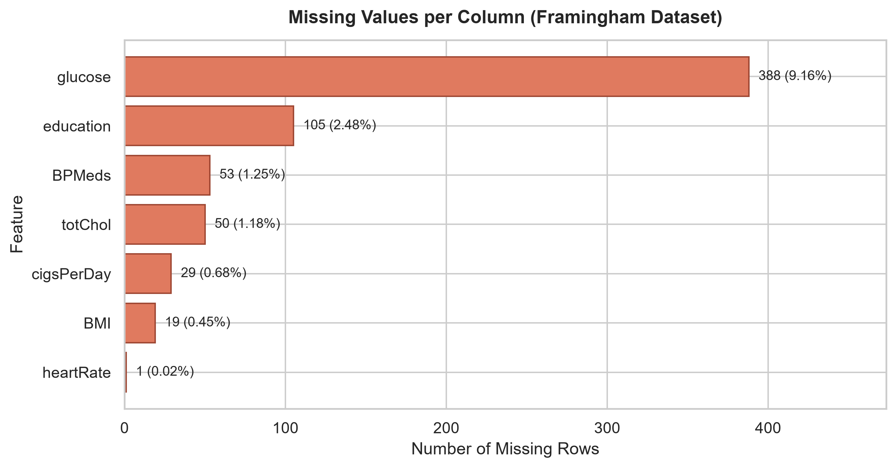

**Figure 1.** Missing values count and percentage across Framingham dataset columns (`reports/eda_missing_values.png`). `glucose` exhibits the highest missingness (388 rows, 9.16%), followed by `education` (105 rows, 2.48%).

### 4.3 Class Imbalance and Exploratory Findings

The target variable `TenYearCHD` exhibits substantial class imbalance:
- **No CHD (`0`):** 3,594 patients (**84.8%**)
- **10-Year CHD (`1`):** 644 patients (**15.2%**)
- **Imbalance Ratio (`0 : 1`):** **5.58 : 1**

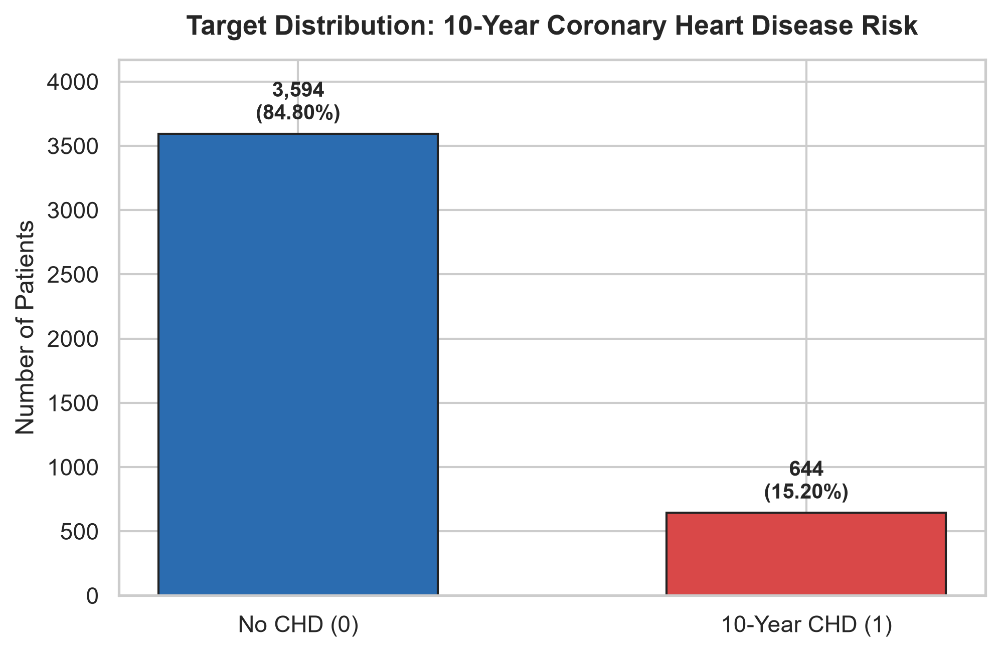

**Figure 2.** Target class distribution (`TenYearCHD`) showing the 5.58 : 1 class imbalance (`reports/eda_target_distribution.png`).

Pearson correlation and stratified distribution analyses (`notebooks/01_eda.ipynb`) reveal that `age` ($r = 0.2253$), `sysBP` ($r = 0.2164$), `prevalentHyp` ($r = 0.1776$), `diaBP` ($r = 0.1453$), and `glucose` ($r = 0.1255$) have the strongest positive linear associations with 10-year CHD. Right-skewed outliers are present in `glucose` (4.88% IQR outliers, max 394 mg/dL), `sysBP` (2.97%, max 295 mmHg), and `totChol` (1.34%, max 696 mg/dL), reflecting genuine severe clinical cases rather than data-entry errors.

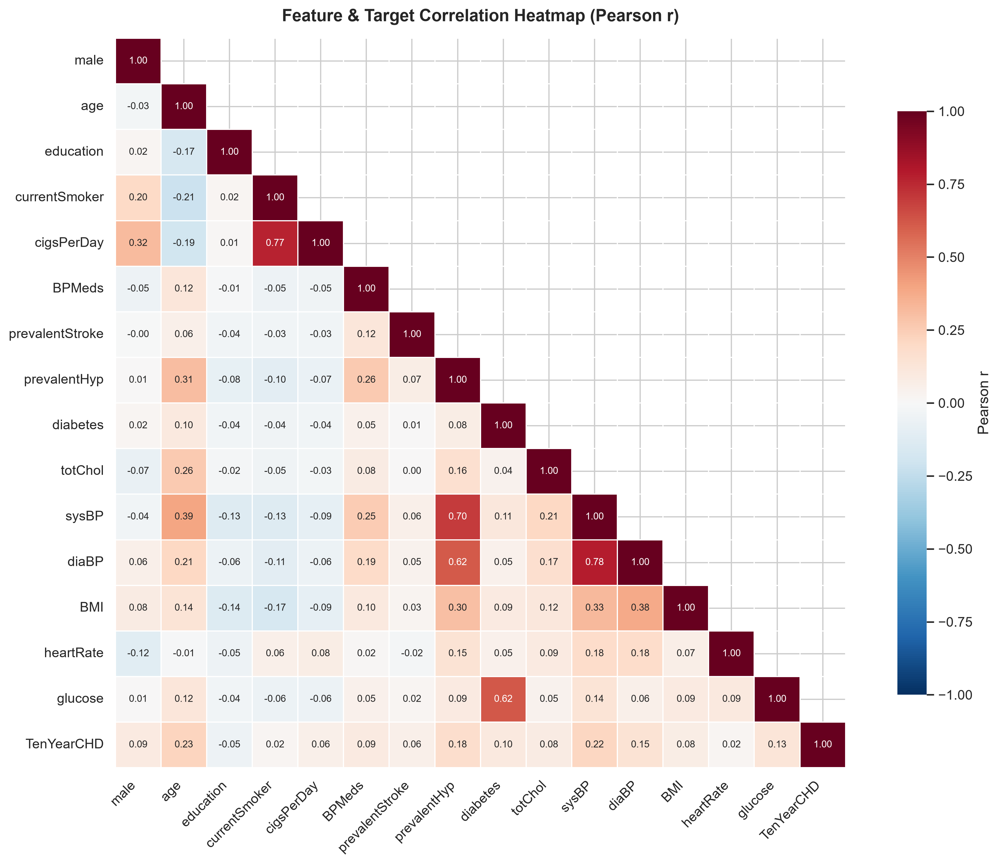

**Figure 3.** Feature correlation heatmap across all 16 Framingham columns (`reports/eda_correlation_heatmap.png`).

---

## 5. Methodology

### 5.1 Pipeline Architecture and Leakage Prevention

To guarantee an unbiased evaluation, CardioSense enforces a strict separation between training and held-out test data in `src/train.py`. Immediately after loading `data/framingham.csv`, `load_and_split_data()` performs a **stratified 80/20 split** with `RANDOM_STATE = 42`:

- **Training Set (80%):** **3,390 rows** (`CHD=0`: 2,875 | `CHD=1`: 515 | CHD Rate: **15.19%**)
- **Held-Out Test Set (20%):** **848 rows** (`CHD=0`: 719 | `CHD=1`: 129 | CHD Rate: **15.21%**)

The held-out test set is untouched during imputation, scaling, SMOTE resampling, hyperparameter tuning, and threshold selection. Every transformation is encapsulated in an `imblearn.pipeline.Pipeline` with three sequential stages:

```
Raw Patient Data (X_train: 3,390 x 15)
        │
        ▼
[Stage 1: ColumnTransformer ("preprocessor")]
  ├── Numeric (8 cols): SimpleImputer(strategy="median") ──▶ StandardScaler()
  └── Categorical (7 cols): SimpleImputer(strategy="most_frequent")
        │  (Fitted ONLY on each CV training fold / full X_train)
        ▼
[Stage 2: SMOTE ("smote", random_state=42)]
  └── Oversamples minority CHD=1 class inside training folds ONLY
      (Automatically bypassed during validation & test prediction)
        │
        ▼
[Stage 3: Classifier ("classifier")]
  └── Candidate Models: LogisticRegression | RandomForestClassifier | XGBClassifier
        │
        ▼
Predicted Probability P(TenYearCHD = 1) ──▶ Tuned Decision Threshold (t = 0.41)
```

**Figure 4 (Conceptual Diagram).** Leakage-free `imblearn` training and inference pipeline architecture implemented in `src/train.py`.

### 5.2 Candidate Models and Hyperparameter Tuning

Three diverse model families are evaluated using **5-fold Stratified Cross-Validation** (`StratifiedKFold(n_splits=5, shuffle=True, random_state=42)`) paired with `RandomizedSearchCV` optimizing `roc_auc`:

1. **Logistic Regression (`solver="saga"`, `max_iter=3000`, `random_state=42`):** Tuned over regularization strength `C`, elastic-net mixing `l1_ratio`, and `smote__k_neighbors`. Best found parameters: `smote__k_neighbors = 3`, `classifier__l1_ratio = 0.0` (L2 penalty), `classifier__C = 0.006158482110660267`.
2. **Random Forest (`RandomForestClassifier`, `random_state=42`):** Tuned over `n_estimators`, tree depth, leaf constraints, and `smote__k_neighbors`. *(Exact full hyperparameter dict was truncated in notebook output; visible prefix: `{'smote__k_neighbors': 3, 'n_estimators': 400, ...}`.)*
3. **XGBoost (`XGBClassifier`, `random_state=42`):** Tuned over `subsample`, `reg_alpha`/`reg_lambda`, `max_depth`, `learning_rate`, `n_estimators`, and `smote__k_neighbors`. *(Exact full hyperparameter dict was truncated in notebook output; visible prefix: `{'smote__k_neighbors': 5, 'subsample': 0.7, ...}`.)*

### 5.3 Evaluation Metrics and Decision Threshold Tuning

Because accuracy is misleading under 85/15 class imbalance, models are compared using **ROC-AUC**, **PR-AUC** (average precision), **Recall** (sensitivity for `TenYearCHD = 1`), **Precision**, **F1-Score**, and **Confusion Matrices**.

To improve screening sensitivity without touching the held-out test set, `src/train.py` computes out-of-fold (OOF) predicted probabilities on the 3,390 training patients and sweeps candidate decision thresholds $t \in [0.10, 0.90]$. Lowering the threshold from the default **$t = 0.50$** to **$t = 0.41$** maximizes CHD recall under a controlled precision tradeoff. The winning pipeline and metadata (`tuned_threshold = 0.41`) are serialized to `models/best_model.pkl` and `models/model_metadata.json`.

---

## 6. Results and Discussion

### 6.1 Cross-Validation and Held-Out Test Performance

Table 2 reports the 5-fold stratified cross-validation scores, and Table 3 reports the held-out test-set evaluation at the default decision threshold ($t = 0.50$).

**Table 2.** 5-Fold Stratified Cross-Validation results on the training set (`N = 3,390`).

| Model | Best CV ROC-AUC | Best CV PR-AUC | Best CV Recall | Best CV F1 |
|-------|-----------------|----------------|----------------|------------|
| **Logistic Regression** | **0.7328** | **0.3652** | **0.6796** | 0.3844 |
| Random Forest | 0.7178 | 0.3352 | 0.6214 | **0.3868** |
| XGBoost | 0.7163 | 0.3307 | 0.5087 | 0.3742 |

**Table 3.** Held-out test-set comparison at default threshold $t = 0.50$ (`N = 848`, `reports/model_comparison.csv`).

| Model | CV ROC-AUC | Test ROC-AUC | Test PR-AUC | Recall | Precision | F1-Score |
|-------|------------|--------------|-------------|--------|-----------|----------|
| **Logistic Regression** | **0.7328** | **0.6985** | 0.2784 | **0.6047** | 0.2476 | **0.3514** |
| Random Forest | 0.7178 | 0.6874 | **0.2864** | 0.5426 | **0.2482** | 0.3406 |
| XGBoost | 0.7163 | 0.6730 | 0.2547 | 0.4186 | 0.2455 | 0.3095 |

Logistic Regression achieves the highest CV ROC-AUC (**0.7328**), highest Test ROC-AUC (**0.6985**), highest Test Recall (**0.6047**), and highest Test F1-Score (**0.3514**), outperforming both tree ensembles. In moderate-dimensional clinical tabular data with predominantly monotonic risk relationships (age, blood pressure, cholesterol, smoking), regularized linear models generalize cleanly without overfitting synthetic SMOTE points.

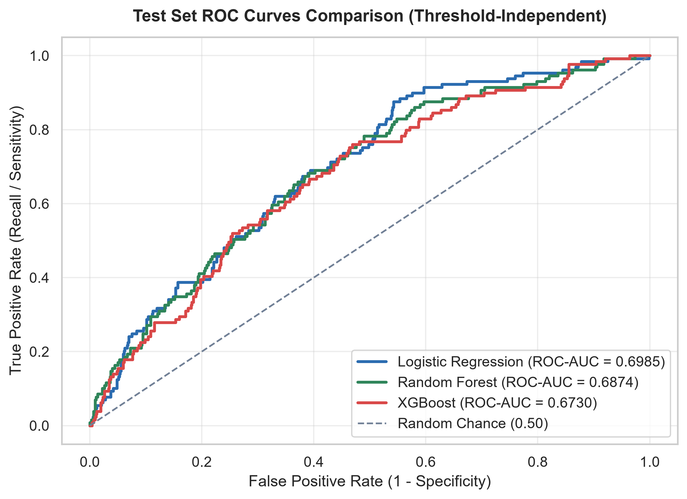

**Figure 5.** Held-out test-set ROC curves for Logistic Regression (AUC = 0.6985), Random Forest (AUC = 0.6874), and XGBoost (AUC = 0.6730) (`reports/roc_curves_comparison.png`).

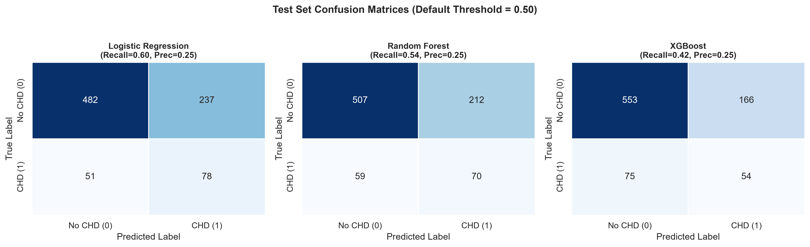

**Figure 6.** Held-out test-set confusion matrices at default threshold $t = 0.50$ (`reports/confusion_matrices.png`).

### 6.2 Threshold Tuning and Why Recall Matters in CHD Screening

In preventive cardiology screening, a **False Negative** (failing to flag a patient who will develop CHD within 10 years) carries far higher clinical cost than a **False Positive** (recommending lifestyle counseling or a follow-up lipid/BP check to a lower-risk patient). Table 4 compares Logistic Regression on the held-out test set before and after lowering the decision threshold to **$t = 0.41$**.

**Table 4.** Logistic Regression test-set performance before vs. after threshold tuning (`N = 848`).

| Setting | Recall | Precision | F1-Score | ROC-AUC | PR-AUC | TN | FP | FN | TP |
|---------|--------|-----------|----------|---------|--------|----|----|----|----|
| Default ($t = 0.50$) | 60.47% | 24.76% | 0.3514 | 0.6985 | 0.2784 | 482 | 237 | 51 | 78 |
| **Tuned ($t = 0.41$)** | **74.42%** | **21.52%** | **0.3339** | **0.6985** | **0.2784** | **369** | **350** | **33** | **96** |

Tuning the threshold from 0.50 to 0.41 increases true positives detected from **78 to 96** (reducing missed CHD cases from **51 down to 33**, a **+13.95 percentage point** gain in recall), while precision shifts modestly from 24.76% to 21.52%.

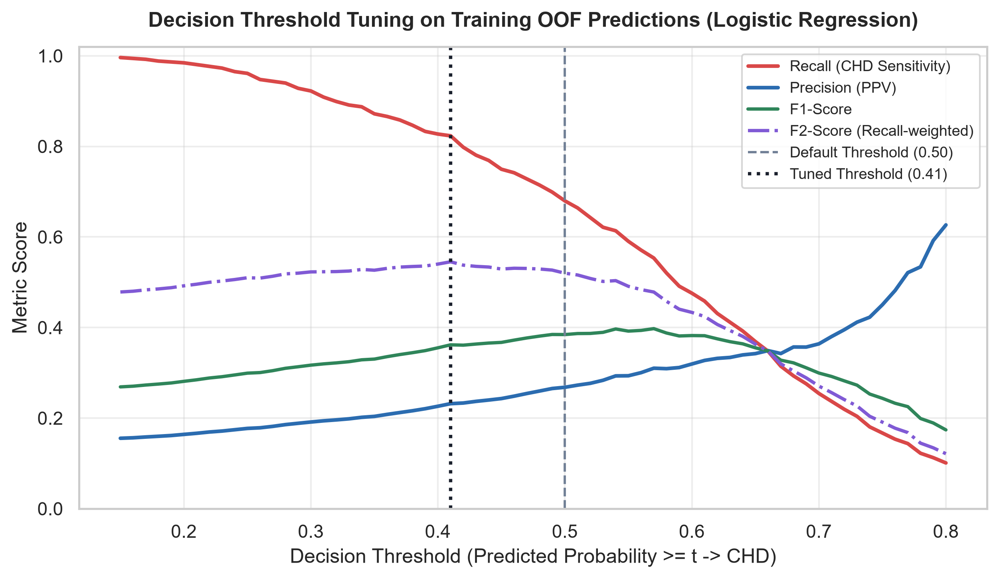

**Figure 7.** Training out-of-fold decision threshold tuning curve (`reports/threshold_tuning.png`).

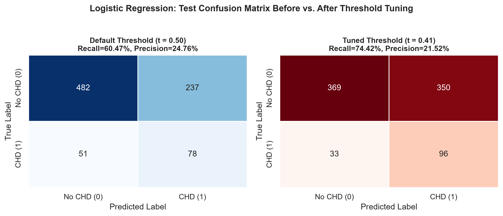

**Figure 8.** Logistic Regression held-out test confusion matrix at $t = 0.50$ vs. $t = 0.41$ (`reports/threshold_confusion_comparison.png`).

---

## 7. Explainability (SHAP and LIME)

### 7.1 Global SHAP Explanations

Because the selected model is `LogisticRegression`, `src/explain.py` uses **`shap.LinearExplainer`** with an independent masker spanning all **3,390** preprocessed training rows (zero subsampling approximation). Across the 848 held-out test patients, Table 5 lists the top 10 features ranked by mean absolute SHAP value.

**Table 5.** Top 10 global features by mean `|SHAP|` value on the held-out test set (`notebooks/03_explainability.ipynb`).

| Rank | Feature | Raw Column | Mean `\|SHAP\|` (log-odds) |
|------|---------|------------|----------------------------|
| 1 | Age (years) | `age` | 0.4830 |
| 2 | Cigarettes / Day | `cigsPerDay` | 0.2263 |
| 3 | Systolic BP (mmHg) | `sysBP` | 0.1868 |
| 4 | Sex (Male = 1) | `male` | 0.1311 |
| 5 | Total Cholesterol (mg/dL) | `totChol` | 0.0815 |
| 6 | Prevalent Hypertension (1 = Yes) | `prevalentHyp` | 0.0711 |
| 7 | Glucose (mg/dL) | `glucose` | 0.0625 |
| 8 | Diastolic BP (mmHg) | `diaBP` | 0.0478 |
| 9 | Education Level (1–4) | `education` | 0.0324 |
| 10 | Heart Rate (bpm) | `heartRate` | 0.0134 |

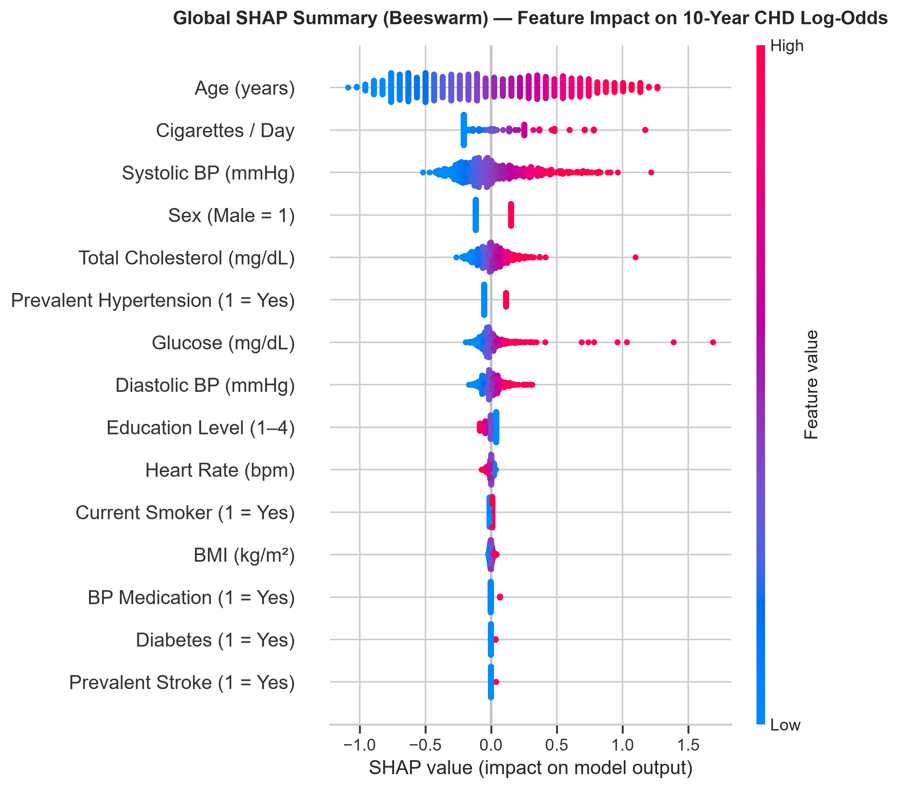

**Figure 9.** Global SHAP beeswarm summary plot across the 848-patient test set (`reports/shap_summary_beeswarm.png`). Higher feature values (red) for age, smoking, systolic BP, male sex, cholesterol, and glucose consistently push predicted CHD log-odds upward.

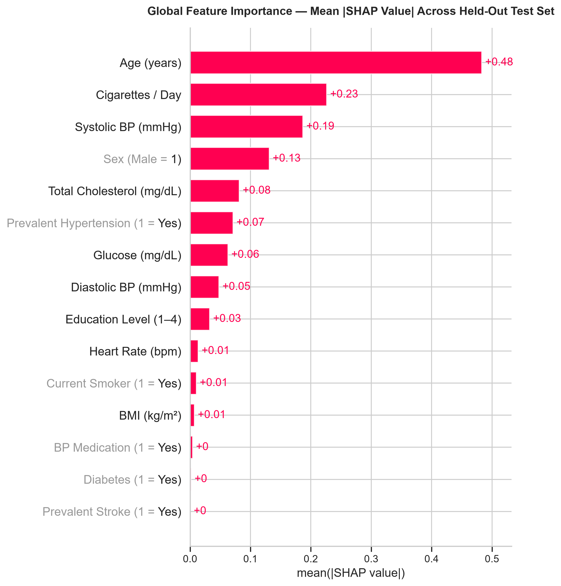

**Figure 10.** Mean absolute SHAP feature importance across the held-out test set (`reports/shap_feature_importance_bar.png`).

### 7.2 Local SHAP Waterfall and LIME Explanations

To verify instance-level interpretability, `notebooks/03_explainability.ipynb` examines two held-out test patients starting from the SMOTE-trained baseline $E[f(X)] = -0.255$ log-odds:

- **High-Risk Test Patient (`P = 89.32%`, Actual = `1`):** 61-year-old male smoker (20 cigs/day) with severe hypertension (`sysBP = 215 mmHg`, `diaBP = 129 mmHg`). Local SHAP attributes `+0.9105` log-odds to `sysBP`, `+0.7435` to `age`, `+0.2533` to `cigsPerDay`, `+0.2434` to `diaBP`, and `+0.1523` to `male`.
- **Low-Risk Test Patient (`P = 9.66%`, Actual = `0`):** 35-year-old female non-smoker with optimal vitals (`sysBP = 98.5 mmHg`, `totChol = 170 mg/dL`). Local SHAP attributes `-0.9561` to `age`, `-0.3734` to `sysBP`, `-0.2066` to `cigsPerDay`, `-0.1584` to `totChol`, and `-0.1159` to `male = 0`.

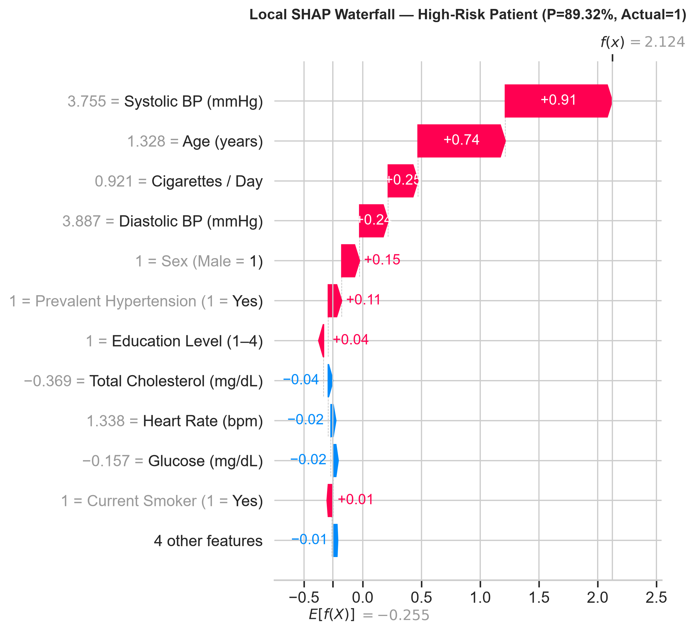

**Figure 11.** Local SHAP waterfall plot for the high-risk test patient (`reports/shap_waterfall_high_risk.png`).

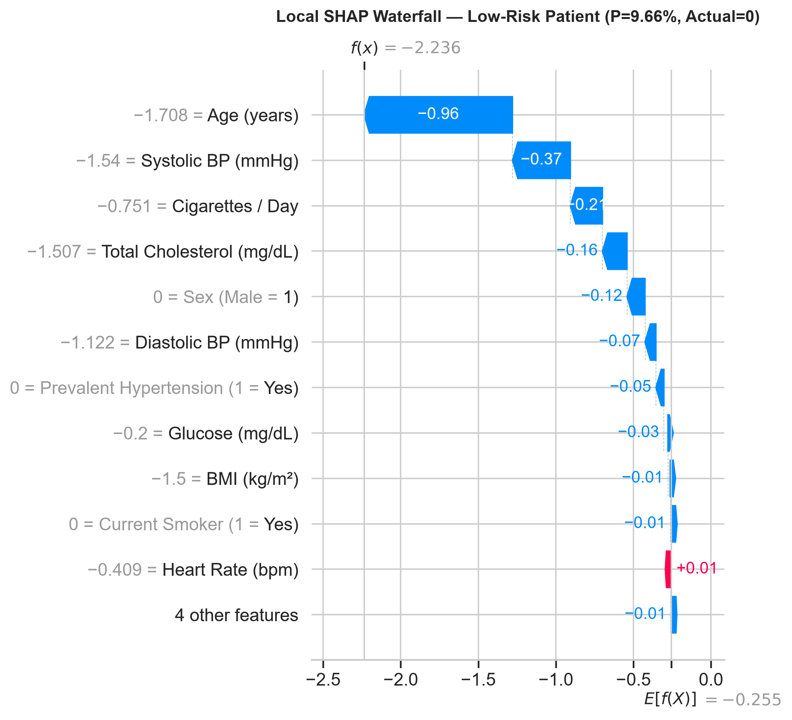

**Figure 12.** Local SHAP waterfall plot for the low-risk test patient (`reports/shap_waterfall_low_risk.png`).

For the same two patients, `LimeTabularExplainer` produces threshold-based local surrogate explanations (`reports/lime_local_explanations.png`).

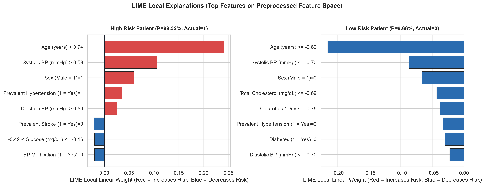

**Figure 13.** LIME local explanations for the high-risk and low-risk test patients (`reports/lime_local_explanations.png`).

### 7.3 Comparison of SHAP vs. LIME

**Table 6.** Conceptual and empirical comparison of SHAP and LIME in CardioSense.

| Dimension | SHAP (`LinearExplainer`) | LIME (`LimeTabularExplainer`) |
|-----------|--------------------------|-------------------------------|
| **Theoretical Basis** | Exact Shapley values (local accuracy, consistency, missingness) | Approximate local linear surrogate on perturbed neighbors |
| **Determinism** | 100% deterministic given training background | Stochastic (depends on perturbation sampling) |
| **Extreme Continuous Values** | Preserves exact standardized magnitude (`sysBP = 215` gets `+0.9105 > age = 61` at `+0.7435`) | Discretizes into quartiles (`sysBP > 0.53`), compressing extreme hypertension and ranking `Age > 0.74` first |
| **Role in CardioSense** | Primary attribution engine (`explain_patient()`) powering the dashboard | Complementary rule-based sanity check |

---

## 8. Recommendation Engine

`src/recommend.py` translates predicted probabilities and patient measurements into structured clinical guidance through two functions:

1. **Three-Tier Risk Stratification (`classify_risk_level()`):** Maps predicted 10-year CHD probability into **Low** (`< 0.10`, green), **Moderate** (`0.10` to `0.25`, amber), and **High** (`> 0.25`, red) using constants `LOW_RISK_MAX = 0.10` and `MODERATE_RISK_MAX = 0.25`.
2. **Personalized Guideline Rules (`generate_recommendations()`):** Evaluates five modifiable risk domains against standard clinical thresholds (Table 7). Recommendations are generated **only** for factors that are elevated or risky for that patient, and are sorted so that **top risk-increasing SHAP drivers** appear first.

**Table 7.** Modifiable risk factor rules and clinical thresholds in `src/recommend.py`.

| Domain | Trigger Condition | High-Severity Cutoff | Guideline Target |
|--------|-------------------|----------------------|------------------|
| **Smoking Cessation** | `currentSmoker == 1` or `cigsPerDay >= 1.0` | `cigsPerDay >= 10` | `0 cigarettes/day` (complete cessation) |
| **Blood Pressure Control** | `sysBP >= 130.0` or `diaBP >= 80.0` or `prevalentHyp == 1` | `sysBP >= 140.0` or `diaBP >= 90.0` | `< 130 / 80 mmHg` (ACC/AHA guideline) |
| **Lipid & Cholesterol** | `totChol >= 200.0` mg/dL | `totChol >= 240.0` mg/dL | `< 200 mg/dL` desirable (`< 240` threshold) |
| **Weight & Activity (BMI)** | `BMI >= 25.0` kg/m² | `BMI >= 30.0` kg/m² | `18.5 – 24.9 kg/m²` |
| **Glycemic & Metabolic** | `glucose >= 100.0` mg/dL or `diabetes == 1` | `glucose >= 126.0` mg/dL or `diabetes == 1` | `< 100 mg/dL` fasting (ADA guideline) |

---

## 9. Interactive Streamlit Dashboard

The web interface (`app/app.py`) provides two tabs: **Risk Assessment & Explainability** and **Model Performance**. A sidebar form collects all 15 patient inputs with clinical range constraints, hover tooltips (`help=`), and physiological validation (blocking prediction with an error banner if `diaBP >= sysBP` or if cigarettes/day > 0 while "Current Smoker" is unchecked). A collapsible *"How to Read the SHAP Waterfall Plot"* guide and an unconditional **Medical Disclaimer** ensure clarity and safe framing.

### 9.1 Moderate-Risk / Low-Driver Profile Walk-Through


**Figure 14.** Risk Assessment header displaying a Moderate Risk card (10.1% 10-year CHD probability, below the 41% tuned screening cutoff) and semi-circular probability gauge (`reports/screenshots/Screenshot 2026-11-27 224349.png`).


**Figure 15.** Local SHAP waterfall plot and Top 5 Contributing Features panel for a younger low-driver patient, showing protective blue bars for age (30 years), systolic BP (110 mmHg), non-smoking, and cholesterol (`reports/screenshots/Screenshot 2026-11-27 224356.png`).


**Figure 16.** Personalized Preventive Recommendations confirming no elevated modifiable risk factors alongside the persistent Medical Disclaimer (`reports/screenshots/Screenshot 2026-11-27 224403.png`).

### 9.2 High-Risk Profile Walk-Through


**Figure 17.** High Risk card (90.3% 10-year CHD probability, above the 41% tuned screening cutoff) and probability gauge in the red tier (`reports/screenshots/Screenshot 2026-11-27 224722.png`).


**Figure 18.** Local SHAP waterfall plot and Top 5 Contributing Features for the high-risk patient, highlighting upward risk drivers: Age 65 (`+1.0050`), Glucose 150 mg/dL (`+0.3796`), Systolic BP 160 mmHg (`+0.3044`), Cigarettes/Day 20 (`+0.2533`), and Male Sex (`+0.1523`) (`reports/screenshots/Screenshot 2026-11-27 224730.png`).


**Figure 19.** Five prioritized preventive recommendation cards generated for the high-risk patient, with SHAP-driver badges on Glycemic Control, Blood Pressure Control, and Smoking Cessation (`reports/screenshots/Screenshot 2026-11-27 224910.png`).

End-to-end verification (`tests/test_samples.py`) across 5 clinical profiles plus min/max edge cases confirmed expected risk stratification from 4.8% (minimum-value edge case, Low) to 99.96% (maximum-value edge case, High), and Streamlit `AppTest` confirmed zero runtime exceptions.

---

## 10. Limitations and Ethical Considerations

1. **Single-Population Historical Cohort:** The Framingham Heart Study enrolled a predominantly white cohort from Framingham, Massachusetts beginning in the mid-20th century. Risk coefficients may not calibrate accurately across diverse ethnic, geographic, or contemporary populations with modern statin and antihypertensive usage.
2. **Not a Medical Diagnostic Tool:** CardioSense is strictly an academic decision-support prototype. Predicted probabilities and rule-based suggestions must not replace clinical judgment, laboratory confirmation (e.g., LDL-C, HbA1c), or physician-supervised treatment.
3. **Class Imbalance and Precision Tradeoff:** With only 15.2% positive CHD cases, optimizing for screening recall (74.42% at $t = 0.41$) yields a precision of 21.52% (350 false positives out of 848 test patients). In practice, positive flags must be framed as prompts for non-invasive preventive review rather than definitive diagnoses to avoid unnecessary patient anxiety.
4. **Probability Calibration After SMOTE:** Because SMOTE oversamples the minority class to 50/50 during training, raw predicted probabilities are shifted upward relative to the true 15.2% population base rate (reflected in the baseline $E[f(X)] = -0.255$ log-odds and observed in `tests/test_samples.py` where a 45-year-old male light smoker received a 37.2% probability). Post-hoc Platt scaling or isotonic calibration on an unresampled validation split would improve absolute probability calibration.
5. **Missing-Value Imputation and Unmeasured Biomarkers:** Simple median/mode imputation (notably for `glucose` with 9.16% missingness) assumes missingness is non-informative, and the 15 Framingham inputs omit modern cardiovascular markers such as HDL-C, LDL-C, hs-CRP, and coronary artery calcium.

---

## 11. Conclusion and Future Work

CardioSense demonstrates how a disciplined, leakage-free machine learning pipeline can deliver both competitive 10-year CHD screening sensitivity and transparent, actionable patient explanations. By isolating an 80/20 stratified split before preprocessing, confining SMOTE inside `imblearn` training folds, and tuning the Logistic Regression threshold to $t = 0.41$, the system achieves **74.42% recall** and **0.6985 ROC-AUC** on the held-out test set. Integrating exact `LinearExplainer` SHAP attributions with clinical guideline thresholds ensures that every risk score is accompanied by clear physiological drivers and personalized preventive steps in an interactive Streamlit dashboard.

**Future Work:**
- Apply **probability calibration** (Platt scaling or isotonic regression) after SMOTE resampling so predicted percentages align closely with true population incidence.
- Validate externally on multi-ethnic contemporary cohorts (e.g., NHANES or UK Biobank) and incorporate **HDL-C**, **LDL-C**, and **HbA1c**.
- Add **counterfactual "What-If" simulation** in the Streamlit UI so patients can visually preview how quitting smoking or lowering systolic BP by 15 mmHg reduces their predicted CHD risk.

---

## 12. References

1. Wilson, P. W. F., D'Agostino, R. B., Levy, D., Belanger, A. M., Silbershatz, H., & Kannel, W. B. (1998). Prediction of coronary heart disease using risk factor categories. *Circulation*, 97(18), 1837–1847. https://doi.org/10.1161/01.cir.97.18.1837
2. Chawla, N. V., Bowyer, K. W., Hall, L. O., & Kegelmeyer, W. P. (2002). SMOTE: Synthetic Minority Over-sampling Technique. *Journal of Artificial Intelligence Research*, 16, 321–357. https://doi.org/10.1613/jair.953
3. Ribeiro, M. T., Singh, S., & Guestrin, C. (2016). "Why Should I Trust You?": Explaining the predictions of any classifier. *Proceedings of the 22nd ACM SIGKDD International Conference on Knowledge Discovery and Data Mining*, 1135–1144.
4. Lundberg, S. M., & Lee, S.-I. (2017). A unified approach to interpreting model predictions. *Advances in Neural Information Processing Systems (NeurIPS)*, 30, 4765–4774.
5. Arnett, D. K., Blumenthal, R. S., Albert, M. A., Buroker, A. B., Goldberger, Z. D., Hahn, E. J., et al. (2019). 2019 ACC/AHA Guideline on the Primary Prevention of Cardiovascular Disease. *Circulation*, 140(11), e596–e646. https://doi.org/10.1161/CIR.0000000000000678

